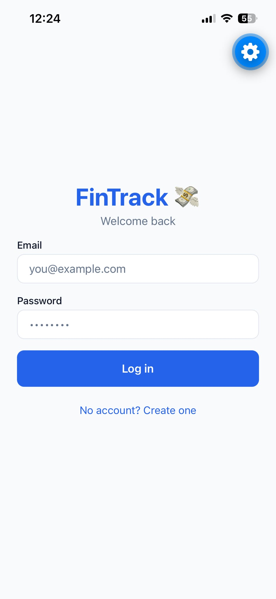
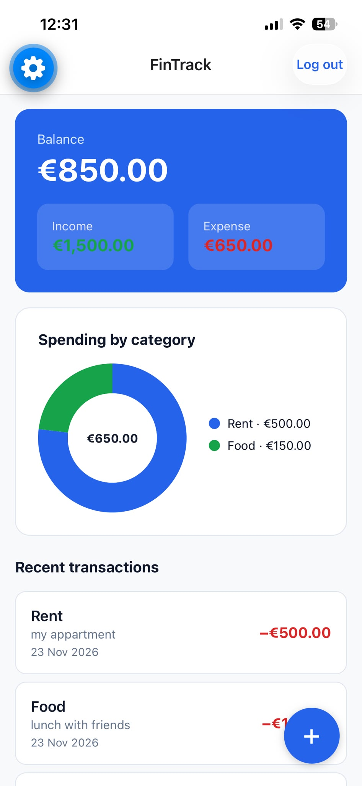
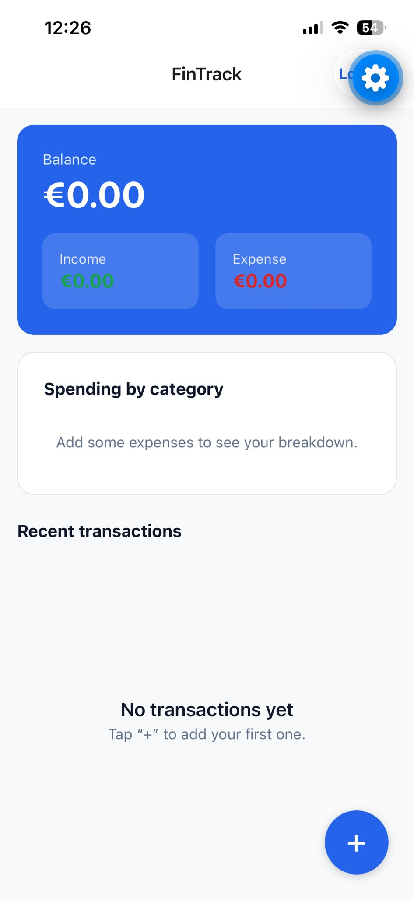

# FinTrack 💸

A full-stack **personal finance mobile app**: track income and expenses, see where
your money goes with a live dashboard, all behind a secure login.

Built end-to-end — React Native mobile app, Spring Boot REST API, PostgreSQL database,
JWT authentication, and CI.


---

## Features

- 🔐 **Secure accounts** — register & log in; passwords hashed with BCrypt, sessions via JWT
- 💰 **Track money** — add, edit, delete income and expenses (amount, category, note, date)
- 📊 **Dashboard** — total balance, income vs. expense, and a spending-by-category donut chart
- 🔒 **Private by design** — every user sees only their own data, enforced at the API layer
- 🔁 **Pull-to-refresh**, loading / empty / error states — polished UX
- ✅ **Tested** — full backend test suite runs automatically on every push

## Screenshots

| Login | Dashboard | Empty state |
|-------|-----------|-------------|
|  |  |  |

## Architecture

```
┌──────────────────────┐    HTTPS / JSON    ┌───────────────────────┐    SQL    ┌──────────────┐
│  Mobile app (phone)  │ ─────────────────► │  Backend API (Spring) │ ────────► │  PostgreSQL  │
│  React Native + Expo │ ◄───────────────── │  JWT-secured REST      │ ◄──────── │   database   │
└──────────────────────┘   Bearer <token>   └───────────────────────┘           └──────────────┘
```

- The app logs in and receives a **JWT**, then sends it on every request.
- The backend verifies the token (stateless — no server session), applies business
  rules in a **Controller → Service → Repository** layering, and persists to PostgreSQL.
- Database schema is versioned with **Flyway** migrations.

## Tech stack

| Layer | Technology |
|-------|-----------|
| Mobile | React Native, Expo (SDK 58), TypeScript, React Navigation |
| Backend | Java 21, Spring Boot, Spring Data JPA, Spring Security |
| Auth | JWT (JJWT) + BCrypt password hashing |
| Database | PostgreSQL 16 (Docker) · H2 for tests |
| Migrations | Flyway |
| Charts | react-native-gifted-charts |
| CI | GitHub Actions |

## Project structure

```
fintrack/
├── backend/     # Java + Spring Boot API (controllers, services, security, migrations)
├── mobile/      # React Native + Expo app (screens, components, api client, auth)
├── docs/        # Design & database documentation
├── docker-compose.yml   # starts PostgreSQL
└── .github/workflows/   # CI
```

---

## Running it locally

### 1. Database (PostgreSQL via Docker)

```bash
docker compose up -d        # starts PostgreSQL on localhost:5432
```

### 2. Backend (Spring Boot)

```bash
cd backend
# run against PostgreSQL:
mvn spring-boot:run -Dspring-boot.run.arguments=--spring.profiles.active=postgres
# or, with zero setup, against in-memory H2:
mvn spring-boot:run
```

The API starts on `http://localhost:8080`. Quick check:

```bash
curl http://localhost:8080/api/health      # -> {"status":"UP",...}
```

Run the tests:

```bash
cd backend && mvn test
```

### 3. Mobile app (Expo)

```bash
cd mobile
npm install
npx expo start
```

Then set your backend address in `mobile/src/config.ts` to your computer's LAN IP
(e.g. `http://192.168.1.50:8080`), scan the QR code with the **Expo Go** app on your
phone, and FinTrack opens on your device.

## API reference

| Method | Path | Auth | Purpose |
|--------|------|:----:|---------|
| POST | `/api/auth/register` | — | Create an account, returns a JWT |
| POST | `/api/auth/login` | — | Log in, returns a JWT |
| GET | `/api/transactions` | ✅ | List my transactions |
| POST | `/api/transactions` | ✅ | Create a transaction |
| GET | `/api/transactions/{id}` | ✅ | Get one |
| PUT | `/api/transactions/{id}` | ✅ | Update one |
| DELETE | `/api/transactions/{id}` | ✅ | Delete one |
| GET | `/api/transactions/summary` | ✅ | Totals + per-category breakdown |

See [`docs/DESIGN.md`](docs/DESIGN.md) and [`docs/DATABASE.md`](docs/DATABASE.md) for more.
